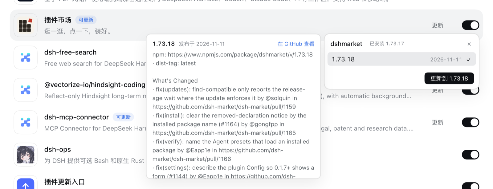
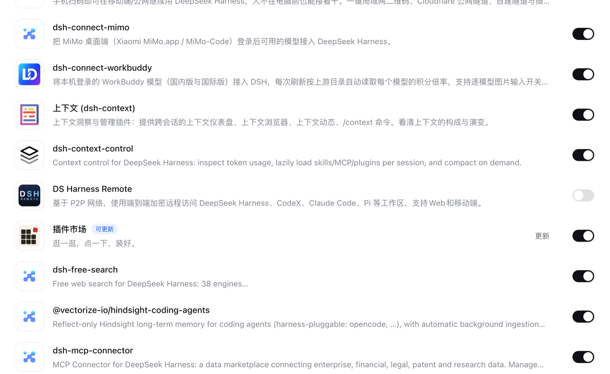

# 插件更新入口 · dsh-plugin-update-entry

一个 DeepSeek Harness 插件：把「更新」放回你每天真正会点的地方——插件卡片上、开关之前。



> **English.** A DSH plugin that puts an update control immediately before each plugin card's
> switch, with a version picker that mirrors the detail page and per-version release notes on
> hover. Same data and same Host operation as the official page — just where the hand already is.

---

## 它解决什么

官方插件页把更新动作放在**详情页**里：列表上的卡片只有一个「可更新」徽标，想知道有什么新版本、要更新到哪个版本，得先进详情页、再点一次。每天扫一眼「有没有可更新的」这件事，被拆成了三步。

这个插件把那一步补回列表：卡片右侧、开关之前多一个「更新」。点开就是版本列表，选一个就地更新，进度和结局都在原地显示。

它**不改动**官方页面的任何逻辑，也不接管更新流程——调用的仍是 Host 自己的 `pluginManager/updateBundle`，所以检查、移除、安装、失败回滚全部沿用官方实现。

## 三个能力

### 1 · 更新入口在开关之前



只有带「可更新」徽标的卡片才会出现入口，其余卡片保持原样。入口高度与开关齐平（22px），行高不变，列表不会因此跳动。

### 2 · 版本选择，和详情页同一套数据

- 只列**比已安装版本新**的版本，新的在前；数量上限跟随 Host 的 `versionListLimit`。
- 每个版本标注：发布日期、`预发布`、`已弃用`、`需要 <peers>`（新版本要求更高的 DSH）、`这个版本没有声明组合包`。
- 不可安装的行会变灰并说明原因；默认选中第一个可安装版本。
- 页脚显示安装源与「另有 N 个版本未列出」，也可切换显示预发布版本。

浮层贴着开关所在的列右对齐；下方空间不足时自动翻到卡片上方。列表是 `role="listbox"`，支持 `↑` `↓` `Home` `End`，`Esc` 逐层关闭。

### 3 · 悬停看这个版本改了什么

指针停在某个版本行上约 140ms，左侧弹出该版本的更新说明；移到气泡里不会消失，移开约 180ms 后消失。说明来自该包的 **GitHub Releases**，按 tag 里的语义化版本匹配。

读不到 Release 时降级为版本元数据（版本、发布日期、标签、是否组合包、所需 DSH），不编造内容。

### 更新过程

选中版本后是就地确认，不弹官方 Modal：

```
将从 0.9.37 更新到 0.9.43，期间插件可能短暂停止。
安装失败时会保留或重新安装 0.9.37。
```

确认后按钮进入进行态，步骤文字跟随 Host 的 `plugin-manager/update-state` 事件（检查 → 停止并移除 → 安装 → 重新安装）。结局沿用官方判定：已更新 / 已安装，重启后生效 / 无法更新 / 无法移除 / 已恢复到旧版本 / 更新失败且插件未安装 / 无法确认结果。失败时展开「查看安装输出」可看到安装器原始日志。

## 安装

在插件页点「添加插件」，填入包名或仓库地址：

```
dsh-plugin-update-entry
```

装好后插件页会多出一行「插件更新入口」，默认启用。它自己也是一个普通组合包，可以随时关掉——关掉后注入的按钮和浮层会一并移除，页面回到原样。

**要求**：DSH 桌面端或 Web 端（Client 侧插件）。插件本身没有 Host 逻辑，不需要重启后端。

## 边界与取舍

| 情况 | 行为 |
| --- | --- |
| 卡片没有「可更新」徽标 | 不注入入口 |
| 官方内置组合包（`official: true`） | 不注入（Host 不允许更新它们） |
| 只有一个可更新版本 | 仍然显示版本列表，只是只有一行 |
| 包没有 GitHub 仓库 | 悬停降级为版本元数据 |
| GitHub API 限流（403/429） | 本会话不再请求该仓库，悬停直接显示元数据 |
| 网络不可用 | 版本列表显示失败原因与「重新检查」，不缓存错误 |
| 想降级 | 不支持，只处理比已安装更新的版本 |

其它已知限制：

- 更新说明只来自 GitHub Releases。仓库把说明写在 CHANGELOG 里、或 release 正文为空时，看到的是元数据而不是正文。
- 未登录的 GitHub API 每个出口 IP 每小时 60 次。正常使用（只在你悬停时请求）不会碰到，但同一出口 IP 下的其它工具会共享这个额度。
- 版本检查会为每个候选版本向 registry 查一次元数据，所以**只在点开时查询**，不做预取、不在页面加载时批量查询。结果缓存 10 分钟。

## 实现说明

### 为什么是 DOM 注入

官方插件页没有「列表卡片动作」插槽：`plugins.item` 只接受官方条目，`plugins.detail.actions` 只在详情页。要满足「在开关之前」这个位置要求，只能在卡片渲染完成后把按钮插进 `.cardEnd`。

这是一处**有意的例外**，边界控制得很死：

| 约束 | 做法 |
| --- | --- |
| 定位方式 | 只认稳定属性：`li[data-plugin-package]`、`[class*="cardEnd"]`、`[class*="bundleToggle"]`、徽标文本 |
| 插入位置 | `cardEnd.insertBefore(slot, cardEnd.firstElementChild)`，即官方为进度点预留的位置之前 |
| React 重渲染 | `MutationObserver` + `requestAnimationFrame` 合并扫描；`cardEnd` 被重建时自动重挂 |
| 卡片移除 | `li` 离开 DOM 即卸载，不残留监听 |
| 卸载 | 所有节点、样式、监听都有对应清理；关掉插件即回到原样 |

不读 React fiber、不改官方组件的状态、不覆盖官方样式。

### 传输层：三级降级

DSH 的 Client 插件要调 Host 服务，常规写法是声明 `inject: ['remote.pluginManager']`。但那样会让整个模块等待命名空间挂载——命名空间没就绪时，按钮根本不会出现。这里改成按需解析，并留了三级降级：

| 层 | 方式 | 用途 |
| --- | --- | --- |
| ① service | `ctx.get('remote.pluginManager')` | 命名空间已挂载时最直接 |
| ② rpc | `connection.rpc.call('/api', 'pluginManager/<method>', { args })` | 拿得到连接、拿不到服务时 |
| ③ fetch | `POST /api/pluginManager/<method>` | 两者都拿不到时，直接走同源 RPC |

`args` 必须是**按参数名索引的普通对象**（`{ name, options }`），不是数组——网关按 `descriptor.parameters` 的 wire 名组装参数，数组会被拒绝。

读操作任何一层失败都可以换下一层；**写操作不行**。`updateBundle` 只在错误能证明「请求根本没发出去」时才降级重试，否则可能把一次更新下发两遍。这条判断在 `viaTiers(..., { mutating: true })` 里。

### 依赖与权限

- 不写 Host 代码：`index.js` 是空实现，插件只提供 Client 模块。
- 不新增依赖：没有 React、没有 UI 组件库，全部用原生 DOM 与官方主题变量。
- 不读其它插件的源码或样式表；样式只使用 `--dsw-*` 主题变量，深色/浅色跟随系统。
- 请求只有两处，都由你触发：registry 的版本元数据（经 Host 的 `listVersions`）和 GitHub Releases（悬停时）。

不收集、不上报任何使用数据。版本说明在 `sessionStorage` 里缓存 20 分钟（关掉标签页即失效），`localStorage` 只用于调试开关。

## 开发

```
client.js             Client 模块：扫描、注入、浮层、版本与说明、更新流程
index.js              Host 侧空实现（组合包需要一个 Host 入口）
cordis.patch.yml      组合包声明
locale/{zh,en}.json   显示元数据
test/pure.test.mjs    纯函数（版本解析、仓库解析、结局映射、错误清洗…）
test/dom.test.mjs     DOM 回归入口
test/harness/         三个 jsdom harness：服务层 / connection.rpc / 仅 fetch
```

```sh
npm install     # 只装 devDependencies：jsdom + @deepseek-ai/cordis
npm test        # 18 条纯函数 + 3 条 DOM 回归
```

`npm test` 不需要 DSH 在跑。三条 DOM 回归分别在 jsdom 里还原官方卡片结构，覆盖插件在浏览器里可能遇到的三种传输形态：

| harness | 上下文 | 证明什么 |
| --- | --- | --- |
| `harness-real.mjs` | 真实 cordis，`remote.pluginManager` 命名空间已挂载 | 按钮在开关前、版本列表、悬停说明、确认后调用 `updateBundle` |
| `harness-transport.mjs` | 只有 `connection.rpc.call` | 降级到网关 RPC，且 `args` 是按参数名索引的对象 |
| `harness-fetch.mjs` | 所有服务都读不到，只剩 `fetch` | `POST /api/pluginManager/<method>` 单独就能撑起完整流程 |

单独跑某一条：`node test/harness/harness-fetch.mjs`。缺 devDependencies 时这三条会跳过，纯函数 18 条照跑。

调试：`localStorage.pueDebug = '1'` 后重新打开浮层，头部会显示构建号，失败信息里会附带每一层的解析结果与原始错误。

## 许可

MIT
